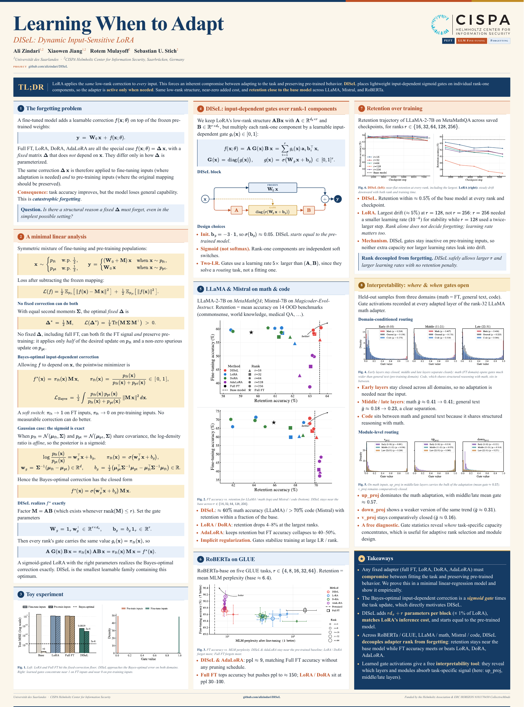
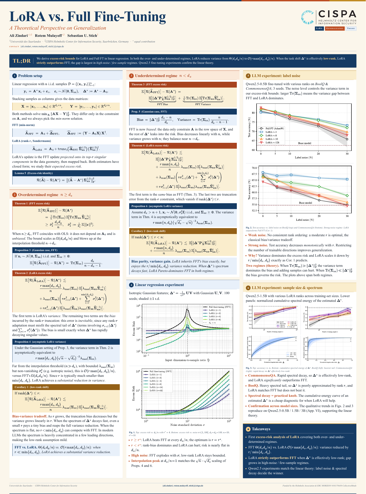
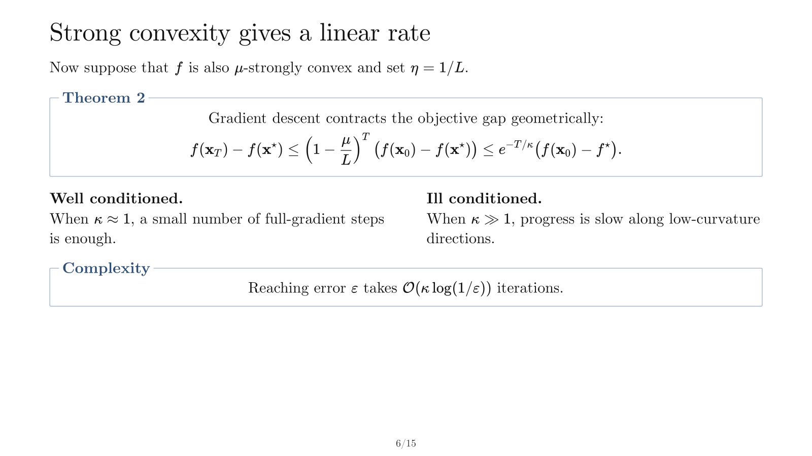
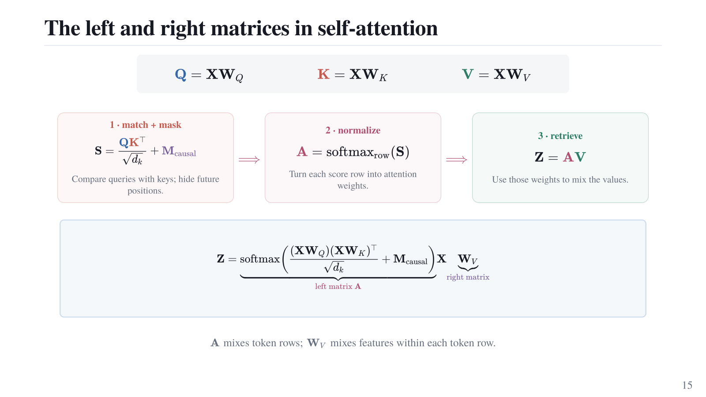
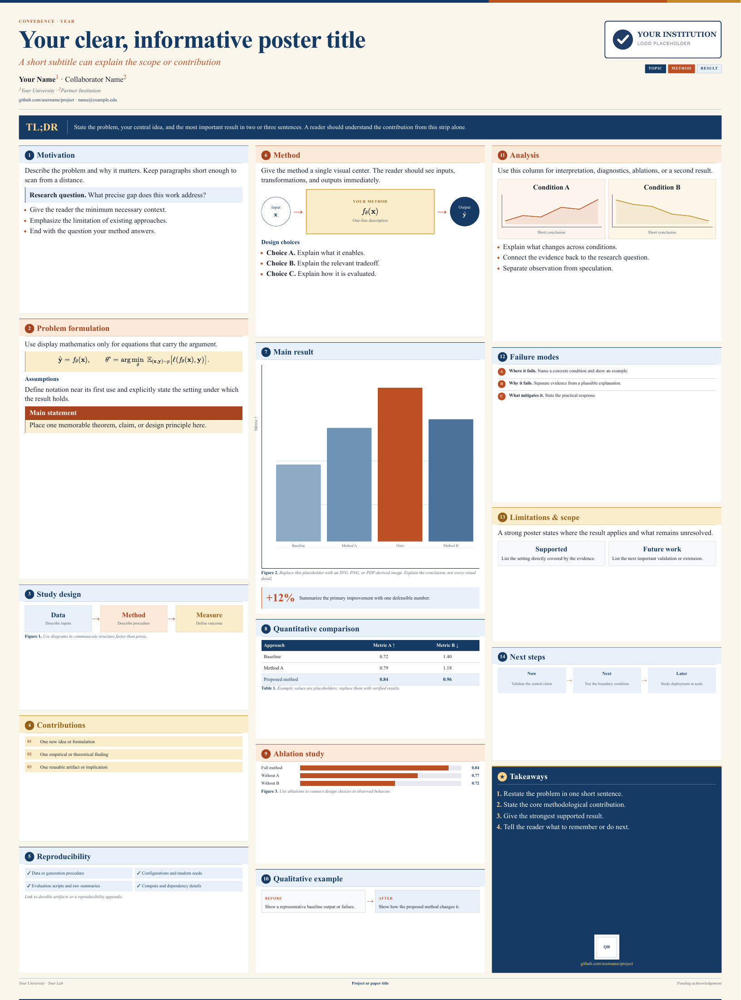
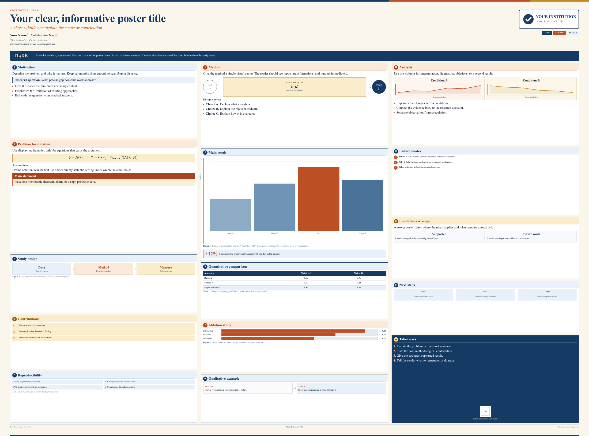

<div align="center">

# Academic Poster & Slide Templates

This repository includes two poster templates, two poster examples, and two
slide styles.

[](https://developer.mozilla.org/en-US/docs/Web/HTML)
[](https://developer.mozilla.org/en-US/docs/Web/CSS)
[](https://developer.mozilla.org/en-US/docs/Web/JavaScript)
[](https://katex.org/)
[](docs/RENDERED_OUTPUTS.md)
[](LICENSE)


**[Browse the templates](#what-is-included) · [Start editing](#quick-start) · [Render every PDF](#pdf-export) · [See the gallery](#rendered-gallery)**

</div>

## Rendered gallery

These previews are generated from the files in this repository. Each one
opens its full PDF.

<table>
  <tr>
    <td width="34%" align="center" valign="top">
      <a href="examples/poster-disel/poster.pdf">
        
      </a>
      <br>
      <strong>Academic poster</strong><br>
      <sub>DISeL: dense research, clear hierarchy</sub>
      <br><br>
      <a href="examples/poster-lora/poster.pdf">
        
      </a>
      <br>
      <strong>Academic poster</strong><br>
      <sub>LoRA vs. Full Fine-Tuning: theory and experiments</sub>
    </td>
    <td width="66%" align="center" valign="top">
      <a href="templates/slides-math/slides.pdf">
        
      </a>
      <br>
      <strong>Elegant theory slides</strong> · <sub>Mathematics without visual noise</sub>
      <br><br>
      <a href="templates/slides-transformer/slides.pdf">
        
      </a>
      <br>
      <strong>Visual transformer slides</strong> · <sub>Color, diagrams, and a teaching narrative</sub>
    </td>
  </tr>
  <tr>
    <td width="34%" align="center" valign="top">
      <a href="templates/poster-vertical/poster.pdf">
        
      </a>
      <br>
      <strong>Vertical poster template</strong><br>
      <sub>860 × 1160 mm portrait canvas</sub>
    </td>
    <td width="66%" align="center" valign="top">
      <a href="templates/poster-horizontal/poster.pdf">
        
      </a>
      <br>
      <strong>Horizontal poster template</strong> · <sub>The same system on a 1160 × 860 mm landscape canvas</sub>
    </td>
  </tr>
</table>

## A personal note

I am somehow allergic to seeing slides or posters that are extremely ugly.
This is especially true given the progress in AI and how quickly and easily it
can do this for us. Ugliness can appear in fonts, colors, shapes, and so on.

In this repository, I have put my own templates for making slides. They might
not be to your taste, but they are a good starting point and already at a good
level. In my opinion, the fonts are among the best choices for text and
mathematics. If you have a better idea, just send me an email and convince me
that it can be improved.

In my opinion, nothing can replace HTML + CSS + JavaScript + LaTeX for slides
and posters. It literally gives you maximum flexibility. And yes, it is hard to
deal with all of them together and make everything work, but with AI, it is
nothing.

Anyway, this repository gives you a nice starting point. You can start with it
and modify it however you wish.

For posters, there are vertical and horizontal versions. Use whichever format
fits your university presentation, conference, or printing requirements.

For slides, there are two types. I personally use the simpler version when it is
a technical presentation, usually for colleagues or collaborators. Therefore,
it is not colorful or fancy. Simple, elegant, and clean slides with a nice font
are more than enough, especially when the mathematics font, which is the most
important part, is right.

The other version is fancier, with colors and shapes. I would use it for a
course, perhaps, or for presenting something to a general audience, schools,
workshops, and so on. Again, use it however you wish.

## What is included

| Format | Character | Best suited for | Open it |
| --- | --- | --- | --- |
| **Vertical poster** | Editorial, structured, and print-ready | Portrait conference posters, workshops, research showcases, machine-learning and technical projects | [Source](templates/poster-vertical/index.html) · [PDF](templates/poster-vertical/poster.pdf) · [DISeL example](examples/poster-disel/index.html) · [PDF](examples/poster-disel/poster.pdf) · [LoRA example](examples/poster-lora/index.html) · [PDF](examples/poster-lora/poster.pdf) |
| **Horizontal poster** | Wide, structured, and print-ready | Landscape poster sessions, wide display boards, university presentations, and technical showcases | [Source](templates/poster-horizontal/index.html) · [PDF](templates/poster-horizontal/poster.pdf) |
| **Elegant mathematical slides** | Quiet, precise, and theorem-oriented | Professional technical talks, research seminars, meetings with colleagues, and discussions with collaborators | [Source](templates/slides-math/index.html) · [PDF](templates/slides-math/slides.pdf) |
| **Visual transformer slides** | Colorful, diagram-rich, and progressive | Courses, tutorials, lectures, student audiences, and general technical explanations | [Source](templates/slides-transformer/index.html) · [PDF](templates/slides-transformer/slides.pdf) |

### The academic poster templates

The poster comes in an **860 × 1160 mm vertical version** and a **1160 × 860 mm
horizontal version**. Both provide a strong title area, a three-column research
narrative, theorem and equation callouts, figure panels, takeaways,
affiliations, and room for project links.

I use navy, rust, and gold accents on a warm background, with colored section
headers and clear math boxes. The two examples and both template orientations
use this style. The text and math fonts stay the same.

The templates also include theorem, proposition, lemma, and corollary boxes
with solid colored headings, so the title stands apart from the statement.
See the [heading variants](shared/poster-system/README.md#theorem-headings).

Both folders use the same base theme. The orientation is an explicit parameter
on the root HTML element: `data-orientation="vertical"` or
`data-orientation="horizontal"`. You can also add `?orientation=vertical` or
`?orientation=horizontal` to the URL for a quick preview without editing the
source.

The blank versions are ready to adapt. Two complete examples show how the same
system handles different research stories: the DISeL poster combines dense
mathematics, plots, diagrams, and experimental results, while the LoRA versus
Full Fine-Tuning poster emphasizes theorem statements, excess-risk bounds, and
the link between theory and language-model experiments. The visual hierarchy
stays readable even when the content is serious and information-heavy.

### The elegant mathematical deck

The convergence of GD and SGD deck is the simple, professional style. It is
intentionally calm: white canvas, generous space, carefully typeset equations,
light theorem boxes, understated blue accents, and centered page numbers.

I use this style when the argument is the main event: proofs, propositions,
optimization theory, mathematical derivations, or a technical conversation
with colleagues and collaborators. It looks close to a carefully prepared
research talk without inheriting the visual clutter of a default slide theme.

The included 15-slide example covers smoothness, convexity, strong convexity,
gradient-descent rates, stochastic gradients, diminishing step sizes, noise
floors, and mini-batching. The subject is generic and public-safe, so it can be
used directly as a structural reference.

### The visual transformer deck

The self-attention deck is the more expressive style. It uses coordinated blue,
coral, green, purple, and rose accents; matrices that remain readable; visual
pipelines; causal masks; token flows; and progressive explanations that build
one idea at a time.

I think this style is especially effective for a course, tutorial, lecture, or
student audience. It is more colorful and playful, but still disciplined enough
for technical material. The included 15-slide sequence develops self-attention
from token representations through queries, keys, values, causal masking,
attention weights, value mixing, and the complete masked-attention equation.

## Typography and mathematics

Typography is part of the technical design, not decoration added afterward. I
chose these families because they make prose and mathematics feel like one
coherent document.

| System | Text typography | Mathematics | Why it works |
| --- | --- | --- | --- |
| **Poster** | Times New Roman, Times, or Liberation Serif | MathJax with TeX-style mathematical fonts | Familiar academic texture, compact enough for dense poster content, and highly legible in print |
| **Elegant slides** | Computer Modern Unicode: Roman, Bold, Italic, and Bold Italic | Locally bundled KaTeX fonts | A crisp paper-like voice that feels natural around theorems, proofs, and equations |
| **Visual slides** | TeX Gyre Termes | Locally bundled KaTeX fonts | Formal enough for technical teaching while remaining strong beside diagrams and color |

I think Computer Modern Unicode and TeX Gyre Termes are particularly beautiful
for academic presentations: they have real mathematical character, excellent
italics, and enough contrast to remain readable from a distance. Equations do
not look pasted into the slide; they belong to the same visual system as the
surrounding text.

The slide decks render mathematics locally with KaTeX, using familiar notation:

```html
<p>Strong convexity gives \(\kappa = L / \mu\).</p>

<div class="equation">
  \[
    f(\mathbf{x}_T)-f^\star
    \le e^{-T/\kappa}\bigl(f(\mathbf{x}_0)-f^\star\bigr).
  \]
</div>
```

## What makes the system useful

- **Real source files.** Content, layout, and interaction live in understandable
  HTML, CSS, and JavaScript.
- **Two deliberate slide personalities.** Choose restraint for a research room
  or visual momentum for a classroom.
- **Two poster orientations.** Start with a portrait or landscape canvas while
  keeping the same components, typography, and visual system.
- **Publication-quality mathematics.** KaTeX and MathJax keep notation sharp and
  selectable instead of flattening it into screenshots.
- **Exact canvases.** Slides use a fixed 1280 × 720, 16:9 layout; posters use
  860 × 1160 mm vertical or 1160 × 860 mm horizontal print canvases.
- **Keyboard navigation.** Arrow keys, Page Up/Page Down, Space, Home, and End
  work without a presentation framework.
- **Direct links.** A URL hash such as `#6` opens a specific slide.
- **Reproducible PDFs.** Every public poster or slide source has a rendered PDF
  next to it, and one command refreshes all of them.
- **Offline slide math.** The KaTeX runtime and fonts are bundled locally.
- **Easy publishing.** The root website works directly with GitHub Pages.

## Quick start

Clone the repository, or choose **Use this template** on GitHub, then serve the
repository root:

```sh
git clone https://github.com/alizindari/academic-slide-poster-template.git
cd academic-slide-poster-template
./scripts/serve.sh
```

Open the format you want:

```text
http://localhost:8000/templates/poster-vertical/
http://localhost:8000/templates/poster-horizontal/
http://localhost:8000/templates/slides-math/
http://localhost:8000/templates/slides-transformer/
```

Then edit the corresponding HTML and CSS files. The browser refreshes
immediately, which makes layout iteration fast and concrete.

## Customization guide

### For a new poster

1. Copy `templates/poster-vertical/` or `templates/poster-horizontal/` into a new
   project folder.
2. Keep `shared/poster-system/` with it so the common theme and orientation
   setting remain available.
3. Replace the title, authors, affiliations, summary, and section content.
4. Add figures under an `assets/` or `figures/` directory.
5. Adjust the palette through the CSS custom properties in
   `shared/poster-system/theme.css`.
6. Keep `data-orientation` and the local `@page` rule on the same orientation.

### For an elegant technical talk

1. Copy `templates/slides-math/`.
2. Keep each page as a `<section class="slide">` inside the deck.
3. Reuse `proposition-box`, `goal-box`, `conclusion`, and equation classes for a
   consistent mathematical rhythm.
4. Replace the GD/SGD material with your own public content.
5. Leave `class="is-active"` only on the opening slide.

### For a visual tutorial

1. Copy `templates/slides-transformer/`.
2. Keep the shared theme and replace the topic-specific layouts in `deck.css`.
3. Reuse the established blue, coral, green, purple, and rose roles so color
   remains systematic.
4. Introduce one conceptual transformation per slide.
5. Keep diagrams in HTML/CSS whenever possible so they remain sharp at any size.

## PDF export

Every rendered document is stored beside its source. Regenerate the complete
set from the repository root:

```sh
./scripts/render-all.sh
```

Render only the slide decks:

```sh
./scripts/render-slides.sh
```

Render one poster:

```sh
./scripts/render-poster.sh templates/poster-horizontal/index.html templates/poster-horizontal/poster.pdf
```

The optional third argument overrides the template orientation during export:

```sh
./scripts/render-poster.sh templates/poster-vertical/index.html /tmp/poster-horizontal.pdf horizontal
```

The slide renderer requires a Chromium-based browser and `pdfunite` from
Poppler. Set `CHROME_BIN=/path/to/chromium` when automatic browser detection is
not appropriate. Poster equations load through MathJax, so poster rendering
requires an internet connection.

The complete source-to-output list is maintained in
[docs/RENDERED_OUTPUTS.md](docs/RENDERED_OUTPUTS.md).

## Repository map

```text
.
├── templates/
│   ├── poster-vertical/              # Blank portrait poster
│   ├── poster-horizontal/            # Blank landscape poster
│   ├── slides-math/                  # Elegant mathematical deck
│   └── slides-transformer/           # Populated visual transformer deck
├── examples/
│   ├── poster-disel/                 # Complete DISeL poster example
│   └── poster-lora/                  # Complete LoRA theory poster example
├── shared/
│   ├── poster-system/                # Shared poster theme and orientation logic
│   └── slide-system/                 # Runtime, print CSS, fonts, and KaTeX
├── docs/
│   ├── assets/                       # README artwork and rendered previews
│   ├── PUBLISHING.md                 # Public-release checklist
│   └── RENDERED_OUTPUTS.md           # Source-to-PDF manifest
├── scripts/                          # Serving and rendering helpers
└── index.html                        # GitHub Pages landing page
```

## Public repository notes

The public tree contains reusable source, examples, font licenses, and final
PDFs. Unpublished research notes, private source material, raw experiment dumps,
and third-party reference PDFs are excluded. The mathematical slides use
standard optimization material, and the populated transformer template contains
only the intended 15-slide self-attention lesson.

See [CONTRIBUTING.md](CONTRIBUTING.md) before opening a pull request and
[docs/PUBLISHING.md](docs/PUBLISHING.md) before publishing a fork. The original
template code is available under the [MIT License](LICENSE); KaTeX, TeX Gyre
Termes, and Computer Modern Unicode retain their bundled licenses.
